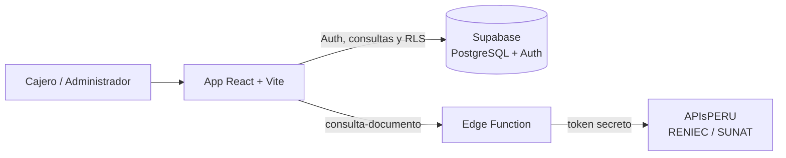
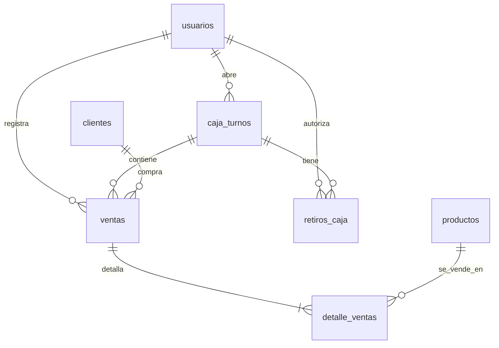

# 🛒 Valkat Store POS

Sistema web de **punto de venta (POS) y control de caja** para **Valkat Store** (Importaciones Adrielito E.I.R.L.), una tienda de cámaras de seguridad y accesorios (CCTV). Reemplaza el registro manual de ventas y el cuadre de caja en papel por una aplicación con roles, turnos de caja, clientes y reportes.

> **Estado:** versión en uso y en evolución. Ver [Hoja de ruta](#-hoja-de-ruta).

---

## 📌 Contexto del problema

En el mostrador de la tienda trabajan varias personas que atienden y manejan dinero. Antes de este sistema:

- El cuadre de caja se hacía a mano y no distinguía entre efectivo, Yape/Plin y tarjeta, lo que producía faltantes y sobrantes difíciles de explicar.
- No quedaba registro de quién vendió qué, ni de los descuentos y retiros de dinero.
- El administrador no tenía forma de ver los productos más vendidos ni el stock crítico sin revisar cuadernos.

**Valkat Store POS** resuelve esto con ventas registradas por turno, cuadre de caja automático, autorización del administrador para descuentos altos y retiros, y reportes de ventas e inventario.

---

## ✨ Funcionalidades

### 👤 Cajero
| Función | Detalle |
|---|---|
| Apertura de caja | Registra el sencillo inicial; solo puede tener un turno abierto a la vez. |
| Venta | Carrito con búsqueda y filtro por categoría, control de stock disponible. |
| Clientes | Venta con cliente (opcional → "Consumidor final"). Búsqueda por nombre o DNI/RUC, registro rápido y **consulta automática en RENIEC/SUNAT**. |
| Medios de pago | Efectivo, Yape / Plin, Tarjeta POS y **Mixto** (efectivo + Yape). |
| Descuentos | Hasta S/ 20.00 libres; **mayores requieren correo y contraseña de un administrador**. |
| Retiro de caja | Solicita un retiro; un administrador lo autoriza con sus credenciales en el mismo momento. |
| Cierre de caja | Cuenta el efectivo, confirma con su contraseña y recibe un resumen: esperado, contado y diferencia (cuadra, sobrante o faltante). |

### 🛠️ Administrador
| Función | Detalle |
|---|---|
| Cuadre y turnos | Lista de todos los turnos con su cuadre. El detalle muestra totales por medio de pago, productos vendidos, ventas con cliente y descuentos, y retiros. |
| Retiros de caja | Puede retirar efectivo de un turno abierto, según lo disponible en caja. |
| Reportes | Productos más vendidos y categoría destacada por período (hoy, 7 días, 30 días, todo), **productos sin rotación** con su valor en stock y stock crítico (menos de 5 unidades). |
| Productos | Alta, edición y baja del catálogo e inventario. |
| Usuarios | Alta de empleados con contraseña temporal (deben cambiarla al primer ingreso) y cambio de rol. |

---

## 🧱 Tecnologías

- **Frontend:** React + Vite + Tailwind CSS
- **Backend como servicio:** [Supabase](https://supabase.com) (Auth, PostgreSQL, Row Level Security, Edge Functions)
- **Consulta de DNI/RUC:** [APIsPERU](https://apisperu.com/servicios/dniruc), a través de una Edge Function para no exponer el token

### Arquitectura



La app solo usa la clave pública (`anon`) de Supabase. Toda la seguridad real vive en la base de datos mediante **Row Level Security** (ver [Seguridad](#-seguridad)).

---

## 🗄️ Modelo de datos



| Tabla | Para qué sirve |
|---|---|
| `usuarios` | Empleados (extiende a Supabase Auth) con rol `admin` o `cajero`. |
| `clientes` | Nombre/razón social, DNI o RUC y teléfono. |
| `productos` | Catálogo con marca, categoría, precio y stock. |
| `caja_turnos` | Apertura, cierre, monto esperado, contado y diferencia de cada turno. |
| `ventas` | Total cobrado, medio de pago, parte en efectivo, cliente y turno. |
| `detalle_ventas` | Productos, cantidades y precios de cada venta. |
| `retiros_caja` | Retiros de efectivo con motivo y administrador que autorizó. |

El script completo está en [`supabase/schema.sql`](supabase/schema.sql).

---

## 📐 Reglas de negocio importantes

- **Cuadre de caja:** `esperado = sencillo inicial + ventas en efectivo − retiros`. Yape/Plin y tarjeta **no** entran al cuadre porque no están en la caja física.
- **Pago mixto:** la parte en efectivo se guarda en `ventas.monto_efectivo`; el resto cuenta como Yape/Plin.
- **Descuento:** se guarda dentro del total cobrado. Los descuentos mayores a S/ 20.00 requieren autorización de un administrador.
- **Retiros:** no pueden superar el efectivo disponible en caja y solo se registran con la sesión de un administrador.
- **Ventas inmutables:** una venta registrada no se puede editar ni borrar desde la aplicación.
- **Fechas:** se guardan en UTC y la app las muestra en hora local.

---

## 🚀 Instalación

### Requisitos
- Node.js 20 o superior
- Una cuenta gratuita de [Supabase](https://supabase.com)
- *(Opcional)* Un token de [APIsPERU](https://apisperu.com) para la consulta automática de DNI/RUC

### 1. Clonar e instalar

```bash
git clone https://github.com/juliodipazdelacruz-stack/<nombre-del-repositorio>.git
cd <nombre-del-repositorio>
npm install
```

### 2. Variables de entorno

Copia `.env.example` a `.env` y completa los valores de **Project Settings → API** en Supabase:

```bash
cp .env.example .env
```

| Variable | Descripción |
|---|---|
| `VITE_SUPABASE_URL` | URL del proyecto, por ejemplo `https://xxxx.supabase.co` |
| `VITE_SUPABASE_ANON_KEY` | Clave pública `anon` del proyecto |

> ⚠️ **Nunca** subas `.env` al repositorio (ya está en `.gitignore`) y **nunca** uses la clave `service_role` en el frontend.

### 3. Base de datos

1. En Supabase abre **SQL Editor**, pega el contenido de [`supabase/schema.sql`](supabase/schema.sql) y ejecútalo. Es repetible: también sirve para actualizar una base existente.
2. Crea el **primer administrador**: en **Authentication → Users** agrega un usuario (correo y contraseña) y luego ejecuta el `insert` que aparece comentado al final de `schema.sql`. Es un paso manual porque crear usuarios desde la app exige ser administrador.

### 4. Autenticación

En **Authentication → Providers → Email**, desactiva **"Confirm email"**. La app crea los empleados desde el panel de administrador y deben poder iniciar sesión de inmediato.

### 5. Consulta de DNI/RUC *(opcional)*

Sin esta función el sistema funciona igual: los clientes se registran escribiendo el nombre a mano.

```bash
npx supabase login
npx supabase link --project-ref <ID_DE_TU_PROYECTO>
npx supabase secrets set APISPERU_TOKEN=<TU_TOKEN>
npx supabase functions deploy consulta-documento
```

El `ID_DE_TU_PROYECTO` son las 20 letras de la URL de tu proyecto (`https://<id>.supabase.co`). El token se guarda como secreto en Supabase y no pasa por el navegador.

### 6. Ejecutar

```bash
npm run dev
```

Abre la dirección que muestra la terminal (normalmente `http://localhost:5173`).

### Scripts disponibles

| Comando | Qué hace |
|---|---|
| `npm run dev` | Servidor de desarrollo con recarga automática |
| `npm run build` | Genera la versión de producción en `dist/` |
| `npm run preview` | Sirve localmente la versión ya construida |
| `npm run lint` | Revisa el código con ESLint |

---

## 🔐 Seguridad

La base de datos aplica **Row Level Security** en todas las tablas, por lo que las reglas se cumplen aunque alguien llame a la API directamente.

| Tabla | Cajero | Administrador |
|---|---|---|
| `usuarios` | Ve solo su fila; solo puede cambiar su `debe_cambiar_password` | Ve, crea y edita a todos |
| `clientes` | Lee y registra | Además edita y borra |
| `productos` | Lee y descuenta stock al vender (no puede cambiar nombre, marca, categoría ni precio) | Control total |
| `caja_turnos` | Abre, ve y cierra solo sus turnos | Ve todos |
| `ventas` / `detalle_ventas` | Registra y ve solo las suyas, dentro de su turno abierto | Ve todas |
| `retiros_caja` | Solo lectura de los de sus turnos | Registra y ve todos |

Además:
- Sin sesión iniciada no se puede leer ninguna tabla.
- Las ventas no se pueden editar ni borrar desde la API.
- Cuando un cajero pide autorización de un administrador (descuentos y retiros), las credenciales se validan con un cliente de Supabase aparte y sin persistencia, de modo que **la sesión del cajero no se reemplaza**.

---

## 📁 Estructura del proyecto

```
.
├── public/                     # Recursos estáticos (logo)
├── src/
│   ├── App.jsx                 # Interfaz y lógica de cajero y administrador
│   ├── supabase.js             # Cliente de Supabase
│   ├── main.jsx                # Punto de entrada
│   └── index.css
├── supabase/
│   ├── schema.sql              # Esquema completo: tablas, índices, triggers, RLS
│   └── functions/
│       └── consulta-documento/
│           └── index.ts        # Edge Function: consulta DNI/RUC (APIsPERU)
├── .env.example                # Plantilla de variables de entorno
├── index.html
├── package.json
├── tailwind.config.js
└── vite.config.js
```

---

## ⚠️ Limitaciones conocidas

- **La venta no es atómica:** se registra la venta, luego sus detalles y después se descuenta el stock en pasos separados desde el navegador. Si falla a la mitad puede quedar una venta incompleta, y con dos cajeros vendiendo el mismo producto a la vez el stock puede descuadrarse.
- No existen anulaciones ni devoluciones: las ventas son inmutables y aún no hay forma de corregirlas.
- El descuento no se guarda como dato propio ni queda registrado quién lo autorizó; solo se refleja en el total.
- No se emiten comprobantes electrónicos: el sistema registra la venta, pero no genera boletas ni facturas válidas ante SUNAT.
- `App.jsx` concentra toda la interfaz en un solo archivo.

---

## 🗺️ Hoja de ruta

- [ ] Venta atómica (función en PostgreSQL) y restricción de que el cajero solo pueda reducir stock
- [ ] Anulaciones y devoluciones con reposición de stock
- [ ] Registrar el descuento y el administrador que lo autorizó
- [ ] Compras e ingreso de mercadería, con proveedores y costos
- [ ] Kardex (físico y valorizado)
- [ ] Facturación electrónica mediante un proveedor autorizado por SUNAT
- [ ] Separar `App.jsx` en componentes y mover la lógica de ventas a su propio módulo
- [ ] Proyecto de Supabase aparte para pruebas

---

## 👤 Autor

Desarrollado por [@juliodipazdelacruz-stack](https://github.com/juliodipazdelacruz-stack) para Valkat Store.
